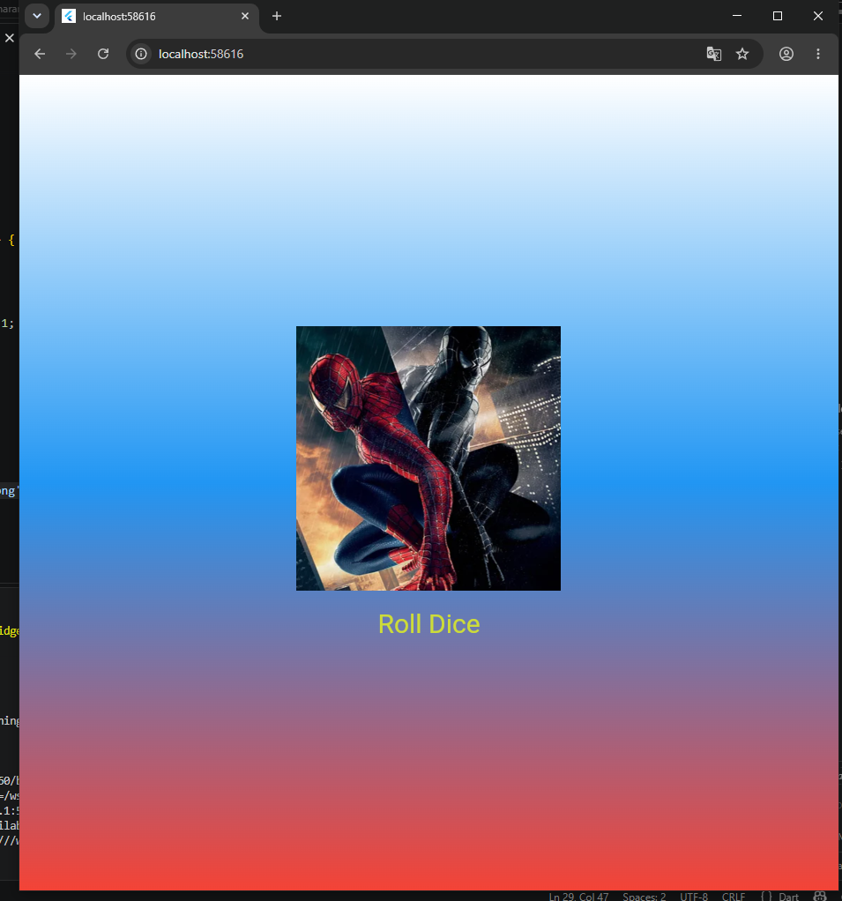

# Лабораторная работа №4-5. Flutter: структура UI и компонентный подход
ФИО: Шаранов Максим Иванович  
Группа: ИСП-242  
Дата сдачи: 07.11.2026

## Что изучили
- Научился разбивать код на отдельные файлы и виджеты.
- Понял, как передавать данные в виджеты через параметры.
- Как сделать кнопку и сделать так чтобы она работала.
- Как передавать цвета и текст в виджеты через параметры.
- Научился подключать картинки из папки assets через файл pubspec.yaml.

## Скриншот финального приложения

## Ссылка на репозиторий
[GitHub](https://github.com/MaxSh67/Flutter_Widgets.git)

## Инструкция по запуску
1. Клонировать репозиторий: `git clone https://github.com/MaxSh67/Flutter_Widgets.git`
2. Перейти в папку: `cd flutter_widgets_sharanov`
3. Установить зависимости: `flutter pub get`
4. Запустить: `flutter run -d chrome`

## Ответы на вопросы
**1. Зачем выносить виджеты в отдельные файлы? Что изменится если держать всё в main.dart?**

Если держать всё в `main.dart`, файл быстро становится огромным и в нём сложно ориентироваться. Вынос в отдельные файлы делает код читабельным, позволяет использовать виджеты в других местах и упрощает поиск нужного куска кода.

**2. Что такое BuildContext? Почему метод build() принимает его как параметр?**

`BuildContext` - это объект, который содержит информацию о положении виджета в дереве виджетов. `build()` принимает его, чтобы виджет мог узнать о своём окружении и правильно перерисовывается. Flutter передаёт его автоматически при каждой перерисовке.

**3. Чем StatelessWidget отличается от StatefulWidget? Приведите пример когда нужен каждый из них.**

`StatelessWidget` не хранит состояние и перерисовывается только при пересоздании. `StatefulWidget` хранит состояние, которое может меняться, и перерисовывается при вызове `setState()`.
- `StatelessWidget` - например, текст "Hello world!", который не меняется.
- `StatefulWidget` - например, наш кубик, который меняет картинку при нажатии .

**4. Почему Random() создаётся на уровне файла, а не внутри rollDice()?**

Если создавать `Random()` внутри `rollDice()`, то при каждом нажатии кнопки создавался бы новый генератор случайных чисел. Создание одного объекта на уровне файла позволяет использовать его повторно.